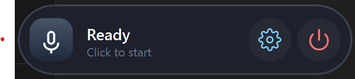
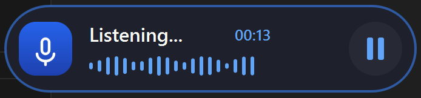
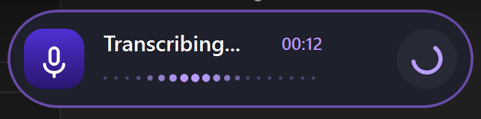
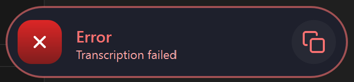

# Hum - Voice to Text Desktop App

**Hum** is a lightweight, floating desktop application that converts speech to text in real-time. Click to start recording, speak naturally, and have your voice instantly transcribed and inserted at your cursor position.

## ✨ Features

- **Floating UI**: Always-on-top pill widget that stays accessible
- **Real-time Transcription**: Powered by local Whisper.cpp for fast, offline processing
- **Smart Text Insertion**: Types transcribed text at your cursor on Linux (X11); copies to the clipboard on Windows for a manual `Ctrl+V`
- **Visual Feedback**: Animated states showing recording progress and status
- **Cross-platform**: Windows and Linux
- **Privacy-first**: All processing happens locally - no cloud services required
- **Self-contained**: Whisper server bundled for Windows; built locally on Linux with one script

## 🚀 Quick Start

### Prerequisites

- Python 3.8+
- Microphone access permissions

### Setup (Windows)

1. **Clone the repository:**
```bash
git clone https://github.com/shoaibsiddiquie/hum.git
cd hum
```

2. **Download a Whisper model:**
   - [ggml-base.bin](https://huggingface.co/ggerganov/whisper.cpp/resolve/main/ggml-base.bin) (~148 MB, recommended)
   - [ggml-tiny.bin](https://huggingface.co/ggerganov/whisper.cpp/resolve/main/ggml-tiny.bin) (~75 MB, faster but less accurate)
   - Place the downloaded `.bin` file in the `models/` folder

3. **Install dependencies:**
```bash
pip install -r requirements.txt
```

4. **Run the application:**
```bash
python main.py
```

> **Note:** `whisper-server.exe` is already included in the `whisper_cpp/` folder — no need to download it separately.

### Setup (Linux)

The repo bundles only the Windows server binary, so Linux builds it locally.

1. **Install system packages** (Debian/Ubuntu shown; adjust for your distro):
```bash
sudo apt install -y python3-venv build-essential cmake git \
                    portaudio19-dev libxcb-cursor0 libxkbcommon-x11-0 libegl1 libgl1 \
                    xclip            # or wl-clipboard on Wayland
```

2. **Build the whisper.cpp server and download a model:**
```bash
./scripts/setup_linux.sh             # or: MODEL=ggml-tiny.bin ./scripts/setup_linux.sh
```

3. **Install Python dependencies and run:**
```bash
python3 -m venv .venv && source .venv/bin/activate
pip install -r requirements.txt
python main.py
```

**Notes for Linux users:**

- **Text insertion** types at your cursor using the X11 `XTEST` extension (via `pynput`), and *also* copies to the clipboard as a fallback. Set `HUM_NO_AUTOTYPE=1` for clipboard-only behaviour.
- **Wayland**: typing at the cursor is X11-only and may not reach native Wayland windows — use `Ctrl+V`, or run under XWayland with `QT_QPA_PLATFORM=xcb`.
- **No `sudo` for cmake?** `pip install cmake` provides a usable one.
- If an existing `whisper-server` is on your `PATH`, Hum will use it instead of building one.

### Building Executable (Optional)

For easier distribution without requiring Python:

**Windows:**
```bash
build.bat
```

The build script will check that a model file exists before building. If it's missing, it will show you the download URL.

**Linux/macOS:**
```bash
./build.sh
```

**Manual build:**
```bash
pip install pyinstaller
python build.py
```

## 🎯 How to Use

1. **Launch Hum** - A floating pill appears at the bottom of your screen
2. **Click to Record** - Click the microphone icon to start recording
3. **Speak Naturally** - The pill shows visual feedback while listening
4. **Auto-transcribe** - Speech is processed locally, then typed at your cursor (Linux/X11) or copied to the clipboard for `Ctrl+V` (Windows)
5. **Continue Working** - The pill returns to ready state for next recording

## 🖼️ UI States & Screenshots

### 1. Ready State (IDLE)
*The default state when Hum is ready to record*

<p align="center">
    
</p>

- **Status**: "Ready - Click to start"
- **Controls**: Settings gear ⚙️ and power button 🔴
- **Action**: Click microphone to begin recording

### 2. Recording State (LISTENING)
*Active recording with real-time audio visualization*

<p align="center">
    
</p>

- **Status**: "Listening..." with timer
- **Visual**: Animated waveform bars showing audio levels
- **Controls**: Pause button to stop recording
- **Action**: Click pause or speak to continue

### 3. Processing State (TRANSCRIBING)
*Audio is being processed by the Whisper engine*

<p align="center">
    
</p>

- **Status**: "Transcribing..." with last recording duration
- **Visual**: Animated dots indicating processing progress
- **Controls**: Spinning loader animation
- **Action**: Wait for transcription to complete

### 4. Success State (COMPLETED)
*Text successfully transcribed and inserted*

<p align="center">
    
</p>

- **Status**: "Inserted - Copied to clipboard"
- **Visual**: Green checkmark in microphone icon
- **Duration**: Shows briefly before returning to Ready state
- **Action**: Automatically returns to Ready after 1.5 seconds

### 5. Error State (FAILED)
*Transcription failed or encountered an error*

<p align="center">
    
</p>

- **Status**: "Error - Transcription failed"
- **Visual**: Red X mark in microphone icon
- **Controls**: Copy button to export error logs
- **Action**: Click to return to Ready state or copy error details

## ⚙️ Configuration

### Audio Settings
- **Sample Rate**: 16kHz (optimized for speech)
- **Format**: 16-bit PCM
- **Channels**: Mono

### Whisper Settings
- **Model**: ggml-base.bin (configurable)
- **Language**: English (configurable via constants.py)
- **Server Port**: 3003
- **Processing**: Local Whisper.cpp server

### Customization
Edit `app/constants.py` to configure:
- Model selection
- Server settings
- Audio parameters
- Language preferences

## 🏗️ Architecture

```
hum/
├── app/                          # Main application logic
│   ├── application.py            # Core app controller & state management
│   └── constants.py              # Configuration settings
├── core/                         # Core interfaces and state definitions
│   ├── interfaces.py             # Abstract base classes
│   └── state.py                  # AppState enum (IDLE, RECORDING, etc.)
├── services/                     # Business logic services
│   ├── audio_recorder.py         # Audio capture using sounddevice
│   └── speech_engine.py          # Whisper.cpp transcription engine
├── backends/                     # Platform-specific implementations
│   └── windows/                  # Windows text insertion & server management
├── ui/                           # User interface components
│   ├── floating_pill.py          # Main floating widget with all states
│   ├── expanded_panel.py         # Settings panel
│   └── theme.py                  # UI styling and colors
├── whisper_cpp/                  # Whisper server (included in repo)
│   └── whisper-server.exe
├── models/                       # Whisper model files (user-provided)
│   └── ggml-base.bin
├── assets/                       # Resources
│   ├── icons/                    # SVG icons for UI buttons
│   └── images/                   # Screenshots of UI states
├── build.py                      # Executable build script
└── main.py                       # Application entry point
```

## 📦 Dependencies

- **PySide6** (>=6.5) - Qt-based GUI framework
- **sounddevice** (>=0.5.3) - Audio recording interface
- **numpy** (>=1.24) - Audio data processing
- **openai** (>=1.0) - Client for Whisper API compatibility

### Build Dependencies (Optional)
- **pyinstaller** - For creating standalone executables

## 🔧 Troubleshooting

### Common Issues

**"Error - Transcription failed"**
- Ensure a model file (e.g., `ggml-base.bin`) exists in the `models/` folder
- Verify microphone permissions and audio levels

**No text insertion**
- Windows only: Ensure proper permissions for text insertion
- Check that target application has focus and accepts text input
- Verify cursor is in a text field

**Floating pill not visible**
- Check if pill is positioned off-screen (drag to center)
- Verify PySide6 installation and Qt dependencies
- Try restarting the application

**Build errors**
- Install PyInstaller: `pip install pyinstaller`
- Run `build.bat` and follow the prompts for missing files
- Check `python test_build.py` to verify build

### Development Setup

```bash
# Clone repository
git clone https://github.com/shoaibsiddiquie/hum.git
cd hum

# Create virtual environment (recommended)
python -m venv venv
source venv/bin/activate    # Linux/macOS
venv\Scripts\activate       # Windows

# Install dependencies
pip install -r requirements.txt

# Run in development mode
python main.py
```

### Logs
Application logs are printed to console with timestamps. Set `logging.DEBUG` in main.py for detailed debugging information.

## 🤝 Contributing

1. Fork the repository
2. Create a feature branch (`git checkout -b feature/amazing-feature`)
3. Commit your changes (`git commit -m 'Add amazing feature'`)
4. Push to the branch (`git push origin feature/amazing-feature`)
5. Open a Pull Request

### Development Guidelines
- Follow existing code structure and naming conventions
- Add type hints to new functions
- Include docstrings for public methods
- Test UI changes across different screen resolutions
- Ensure cross-platform compatibility when possible

## 📄 License

This project is licensed under the MIT License - see the [LICENSE](LICENSE) file for details.

## 🙏 Acknowledgments

- [Whisper.cpp](https://github.com/ggerganov/whisper.cpp) - Fast local speech transcription engine by Georgi Gerganov
- [PySide6](https://www.qt.io/qt-for-python) - Cross-platform GUI framework
- [sounddevice](https://python-sounddevice.readthedocs.io/) - Real-time audio I/O

---

**Made with ❤️ for seamless voice-to-text workflow**

> 💡 **Tip**: Press `Ctrl+C` in the terminal to stop the application, or use the power button in the floating pill.
